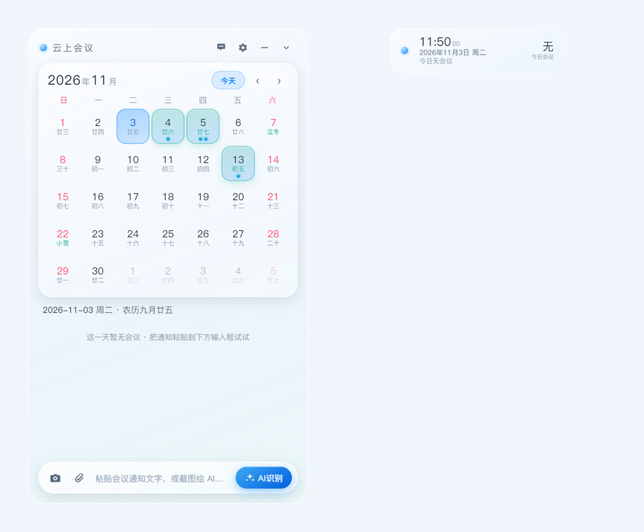

# 📅 云上会议

**Windows 桌面 AI 会议日历挂件 · 一键识别会议通知 · 万年历 + 吸顶小窗 + OTA 在线更新**

一个透明无边框的桌面会议小部件（Electron）。把会议通知粘贴进来或截个图，AI 一键提取会议主题、时间、地点、参会人，自动写进万年历并生成 `.ics` 导入系统日历；拖到屏幕顶端收起成胶囊小窗常驻桌面，悬停即刻展开。



## ✨ 功能一览

### 🤖 AI 一键识别

- 📋 **粘贴即识别**：会议通知文字直接粘贴，或粘贴 / 选择截图，AI 自动提取会议主题、日期、起止时间、地点、参会人、备注
- 🖼 **区域截屏**：内置全屏遮罩框选截图，只截取通知区域给 AI（挂件自动隐藏不挡屏；抓屏与裁剪全在主进程完成，4K / 高 DPI 下不黑屏不卡死）
- 🔓 **免 Key 本地解析**：没配 API Key 也能用——纯文字通知走本地规则解析（日期 / 时间 / 地点 / 参会人），零成本即贴即记
- 🧠 **自定义模型**：任意 OpenAI 兼容接口（`baseUrl` + 模型名 + API Key），gpt-4o-mini / qwen-vl-plus 等视觉模型均可
- 🎚 **AI 风格滑块**：严谨 ←→ 灵活（temperature 映射），提取会议默认「严谨」，照原文提取不编造
- ⚡ **免确认直写**：可开启「识别后自动写入日历」，识别即入库

### 📅 万年历

- 📆 农历、节气、传统节日（春节 / 端午 / 中秋 / 七夕 …）
- 🏮 法定节假日「休 / 班」标注（跟随国务院安排，含调休上班日）
- 🟩 **有会议的日期醒目高亮**，点击日期查看当日会议列表
- 🕐 只写日期或「上午 / 下午」的会议原样记录，**不再显示「时间待定」**；时段进备注，导出 `.ics` 按全天事件处理
- ✏️ 点击会议卡片进详情：随时修改、删除，参会人可勾选调整

### 👥 参会人管理

- 🧑‍💼 常用参会人库：识别 / 输入过的姓名自动记忆，下次直接勾选
- ✅ AI 识别到的参会人自动打勾，临时人员一键并入名单

### 🪟 桌面体验

- 📌 **吸顶胶囊小窗**：拖到屏幕顶端自动收起为「今日会议」小窗（时间 / 日期 / 今日会议 / 场次），悬停原地展开完整面板，移开自动收回
- 💎 **iOS 液态玻璃**：透明无边框 + 亚克力材质，沉浸式玻璃拟态
- 📎 **导出系统日历**：写入即生成 `.ics` 并在文件夹中定位（可选自动打开导入，不弹系统关联窗）
- ⚡ 开机自启、窗口置顶（floating 级别，默认关不遮挡应用）、数据本地记忆

### 🔄 OTA 在线更新

- 📡 内置 GitHub Releases 更新源（可自定义），启动自动检查
- 🆕 发现新版本弹窗提醒 → 后台下载 →「立即安装」重启完成升级
- ✅ sha512 校验 + blockmap 差分下载

## 📋 目录

- [功能一览](#-功能一览)
- [快速开始](#-快速开始)
  - [下载安装](#下载安装)
  - [开发与构建](#开发与构建)
  - [OTA 更新部署](#ota-更新部署)
- [目录结构](#-目录结构)
- [常见说明](#-常见说明)
- [致谢](#-致谢)
- [免责声明](#️-免责声明)

## 🚀 快速开始

### 下载安装

前往 [Releases](https://github.com/kmnn111/cloud-meeting-widget/releases) 下载最新的 `CloudMeeting-Setup-x.y.z.exe`，双击安装即可。装好后常驻托盘，首次打开会引导配置 AI 模型（接口地址 / 模型名 / API Key）。

### 开发与构建

```
git clone https://github.com/kmnn111/cloud-meeting-widget.git
cd cloud-meeting-widget
npm install        # 安装依赖
npm start          # 开发运行
npm run dist       # 清理旧产物 + 打包 NSIS 安装包 → dist/CloudMeeting-Setup-x.y.z.exe
```

> `npm run dist` 会先自动清空 `dist/` 里的历史版本安装包，只保留当次构建产物。

AI 识别走任意 **OpenAI 兼容接口**（`/chat/completions`，视觉模型传 `image_url`），在 设置 → AI 模型 里填 `baseUrl` / 模型名 / API Key 即可，支持 `temperature` 风格调节。

### OTA 更新部署

发新版时，把 dist 目录下 **3 个文件**上传到同一个 HTTP(S) 目录（或 GitHub Release）：

| 文件 | 说明 |
| --- | --- |
| `latest.yml` | 更新元数据（版本号、校验和） |
| `CloudMeeting-Setup-x.y.z.exe` | 安装包本体 |
| `CloudMeeting-Setup-x.y.z.exe.blockmap` | 差分更新块映射（可选，缺失则全量下载） |

用户端两种接入方式：

1. **内置更新源**（推荐）：`main.js` 的 `DEFAULT_UPDATE_URL` 已内置 GitHub Releases 直链，装好即自动收到更新提醒（也可打包前改为自己的目录地址）；
2. **手动配置**：在 设置 → 通用 里填写更新服务器地址。

## 📁 目录结构

```
cloud-meeting-widget/
├── main.js             # 主进程：单窗口吸顶胶囊 / 托盘 / OTA / IPC
├── preload.js          # 上下文桥接
├── capture-preload.js  # 截图选区窗口通信
├── holidays.js         # 法定节假日 / 调休数据（2025-2026）
├── local-extract.js    # 免 Key 本地规则解析（未配模型时兜底）
├── clean-dist.js       # 打包前自动清理旧版本产物
├── renderer/
│   ├── index.html      # 主面板 + 吸顶胶囊
│   ├── app.js          # 万年历 / AI 识别 / 会议与人员管理
│   ├── style.css       # iOS 液态玻璃主题
│   └── capture.html    # 全屏遮罩拖拽选区截图
├── icon.png            # 应用图标
├── preview.png         # 预览图
└── dist/               # npm run dist 产物（安装包 + latest.yml）
```

## 📝 常见说明

- **吸顶交互**：小窗悬停展开、移开收回；左侧圆形抓手只用于拖动（拖离顶部即退出吸顶），悬停请落在小窗文字区域。
- **`.ics` 不弹窗**：写入日历默认只在资源管理器中定位 `.ics` 文件（双击导入系统日历），不会触发「始终使用此应用打开」的系统关联弹窗；如需自动打开可在设置中开启。
- **参会人记忆**：识别或手动输入过的姓名自动存入人员库，下次在确认卡里直接勾选。
- **没有 API Key？** 纯文字会议通知无需 Key：未配置模型时自动走本地规则解析（中文正则提取日期 / 时间 / 地点 / 参会人，结果仅供参考请核对）；截图识别才需要视觉模型，可选智谱 GLM-4V-Flash、SiliconFlow 等免费档。
- **调试自检**：`CM_DEBUG=1`、`CM_SHOT` / `CM_SHOT_DOCK` / `CM_SHOT_CAPTURE` 为开发截图自检入口，日常使用无需关心。

## 🙏 致谢

- [solarlunar](https://github.com/jjonline/calendar.js) — 农历与公历转换
- [OpenAI](https://platform.openai.com) 及各兼容接口服务 — 会议信息提取
- [Electron](https://www.electronjs.org) / [electron-builder](https://www.electron.build) / [electron-updater](https://www.electron.build/auto-update) — 桌面壳、打包与在线更新

## ⚠️ 免责声明

本项目为个人自用工具，仅供学习交流，请勿用于商业用途。AI 提取结果取决于所配置模型的能力，请以会议通知原文为准；导入系统日历前建议核对识别结果。使用本项目产生的任何问题由使用者自行承担。

---

**作者：大软子哥哥** · 如果对你有帮助，欢迎点个 ⭐ Star
